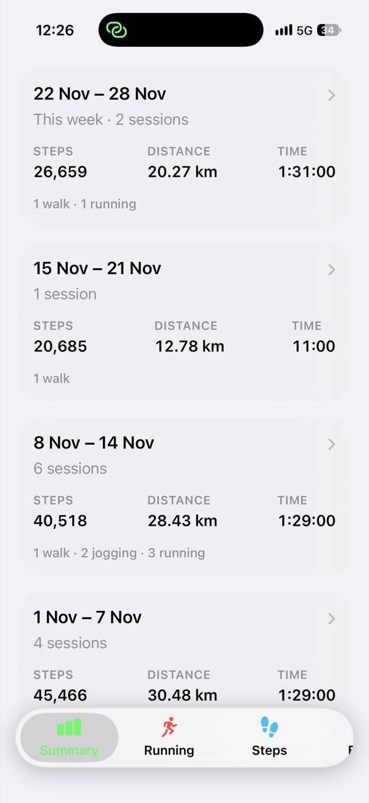
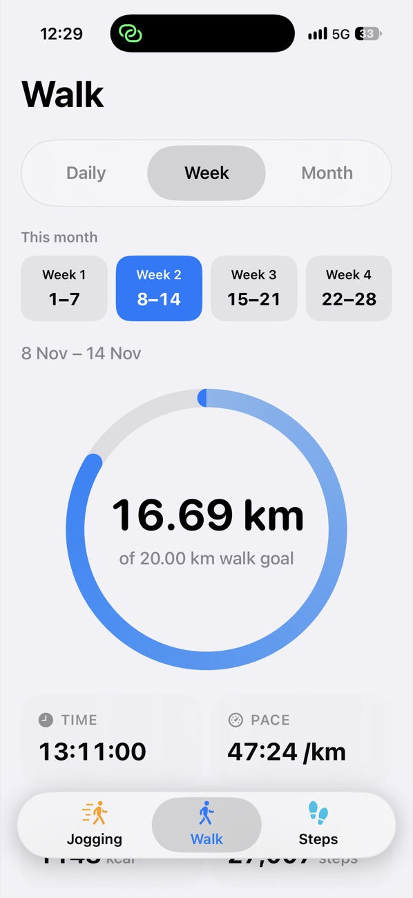
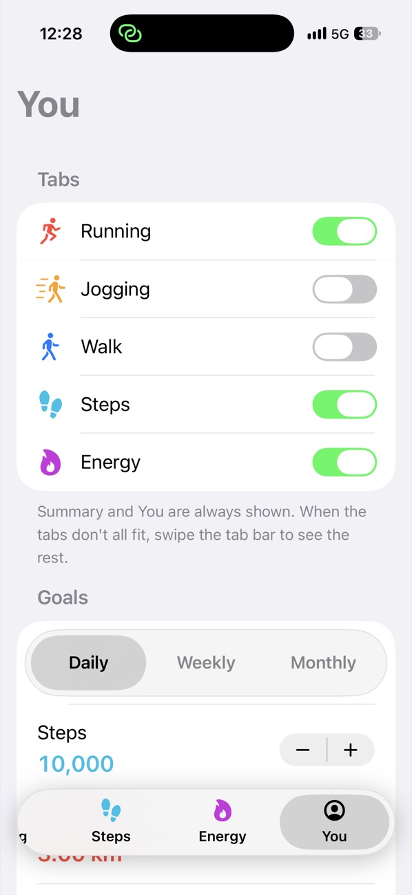
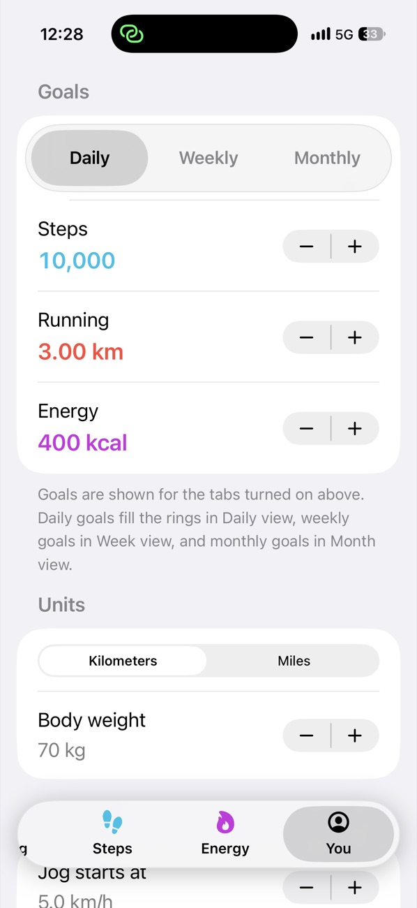

# RunCheck: Walk & Run Stats

RunCheck turns the steps and workouts already in Apple Health into clear walk, jog and run stats on iPhone. It sorts your movement by speed, lists real sessions (not pacing around the house), and shows daily, weekly and monthly totals.

No account, no ads, works offline. RunCheck only reads Apple Health, and your data never leaves your iPhone.

<p align="center">
  
  
  
  
  
</p>
<p align="center">
  
  
  
  
  
</p>
<p align="center">
  
  
  
</p>

## Features

The full list, with screenshots of each screen, is in [docs/features.md](docs/features.md).

### Tabs
- **Summary** and **You** are always shown. **Running**, **Jogging**, **Walk**, **Steps** and **Energy** are optional tabs; only Running is on by default. Turn the others on in **You → Tabs**.
- When the tabs don't all fit, swipe the tab bar.
- Each kind has one colour everywhere: Summary green, Running red, Jogging orange, Walk blue, Steps cyan, Energy purple.

### Daily, Week and Month
- **Daily**: tap a day in this week's strip, and swipe it to go to earlier weeks.
- **Week**: this month's weeks as **Week 1**, **Week 2**… chips. Tap one, and swipe to change months.
- **Month**: the whole month.
- The chosen period, day or week, and the scroll position stay the same when you switch tabs.

### Summary
- One ring per tab that's on, one inside the other, each filled against its own goal for the period. Empty rings are hidden.
- Distance, steps, energy and time totals.
- **Walk**, **Jogging** and **Running** cards with distance, time, speed and energy, shown when that kind has a session. Tap a card to open the session, or the list when there are several.
- **By each day** in Week: small rings, coloured bars and steps for each day.
- In Month, a card for each week with its sessions by kind. Tap a week to open it.

### Running, Jogging and Walk
- A ring with distance against that kind's goal, plus time, pace, energy and steps.
- **By each day** distance in Week and Month.
- That kind's sessions, titled by date (like "22 Nov") with the start time. Hidden when there are none.

### Steps and Energy
- **Steps**: steps against the step goal, distance, energy, and steps **By each day**.
- **Energy**: active energy against the energy goal, time, steps, energy by kind, and energy **By each day**.

### Sessions
- Built from Health's minute-by-minute speed. Runs are found first, then jogs, then walks, and each minute belongs to one session, so a long run with a few slow minutes stays one run.
- Walk sessions only count steady walks, so moving around at home or the office adds to Walk totals but isn't listed.
- Session detail: **Distance**, **Avg speed**, **Energy** and **Steps** tiles; Speed, Pace and Tempo cards (average, minimum, maximum); a graph; and **Each km** (or mile) with the time and speed for each one.

### You
- **Tabs**: turn the optional tabs on or off.
- **Goals**: daily, weekly and monthly goals for steps, energy, and running, jogging and walking distance. Only the tabs that are on show their goals.
- **Appearance**: System (default), Light or Dark.
- **Units**: kilometres or miles, and body weight (used to estimate energy).
- **Pace**: the speeds where jogging and running start.
- **Sessions**: the minimum length and the join window for walks, jogs and runs.
- **Apple Health**: access status, and a shortcut to allow or manage it.
- **About**: version, Check for Updates, Privacy Policy and Support.

### Behind the scenes
- If Health access is missing, RunCheck asks again on launch, and offers to open Health when it still can't read anything.
- About once a day it checks the App Store for a newer version and offers to update.
- Week and Month results are cached and prepared in the background, so they open without a wait. A loading card shows if they're not ready yet.

## How activity is classified

Defaults, all editable in **You**:

| Kind | Speed | Minimum session | Breaks joined if shorter than |
|---|---|---|---|
| Walk | under 5 km/h | 10 min | 2 min |
| Jogging | 5 to 8 km/h | 5 min | 30 s |
| Running | over 8 km/h | 5 min | 10 s |

Short breaks inside a session are joined into it, and a slower stretch of up to 3 minutes (such as a walk break during a run) stays part of the run. Because Health data comes in one-minute steps, a break of a minute or less is always joined.

Health data is loaded on launch, when the app comes back from the background, and when you pull to refresh. Switching between Daily, Week and Month doesn't query Health again. HealthKit background delivery refreshes step totals when Health gets new data.

## Privacy

- **Read only.** RunCheck reads steps, walking and running distance, walking and running speed, active energy, exercise minutes and workouts. It never writes to Apple Health.
- **Nothing leaves the iPhone.** No servers, accounts, analytics, ads or third-party SDKs. Health data isn't stored in iCloud.
- **Update check.** About once a day RunCheck asks Apple's App Store lookup service (`itunes.apple.com/lookup`) for its latest version number and offers to open the App Store if a newer one is out. The request carries only the app's App Store ID and a country code. It's the only network request the app makes.
- **Settings** (tabs, goals, appearance, units, weight, thresholds) are saved on the device.

App Store privacy label: **Data Not Collected**. Full policy: [mujassir.com/runcheck/privacy](https://mujassir.com/runcheck/privacy/). Support: [mujassir.github.io/ios-fitness-app/support](https://mujassir.github.io/ios-fitness-app/support). Product site: [mujassir.com/runcheck](https://mujassir.com/runcheck/).

## Requirements

- macOS with Xcode 16 or later, and [XcodeGen](https://github.com/yonaskolb/XcodeGen)
- An iPhone running iOS 18 or later (HealthKit works best on a real device with Health data)
- An Apple developer team for signing (HealthKit needs a signed build)

## Build and run

```bash
brew install xcodegen   # if needed
xcodegen generate
open Stride.xcodeproj
```

Choose your development team in Xcode, then run on an iPhone. On first launch, tap **Continue**, then **Turn On All** and **Allow** on the Health sheet. Pull down on Summary to refresh.

`project.yml` is the source of truth. Edit it, not the `.xcodeproj`, then run `xcodegen generate` again.

## Project

| | |
|---|---|
| App Store name | RunCheck: Walk & Run Stats |
| Bundle ID | `com.mujassir.runcheck` |
| Version | 1.0.0 (build 2), iPhone only |
| Project spec | `project.yml` (XcodeGen). The target and folder are still called `Stride`, the app's working name |
| Store and review docs | [`docs/appstore/`](docs/appstore) (metadata, review notes, readiness checklist) |
| Website | [`docs/`](docs), published with GitHub Pages |
| License | [Apache 2.0](LICENSE) |

### Not in 1.0

GPS workout recording (the Move and Log screens, live routes and saving workouts to Health) is in the repo but excluded from the 1.0 target in `project.yml`. It needs location access and Health write access, which 1.0 doesn't ask for. It's planned for a later version.
