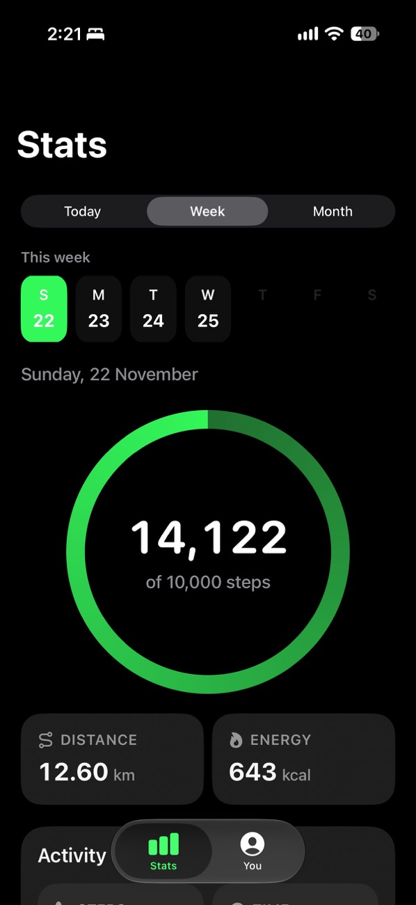
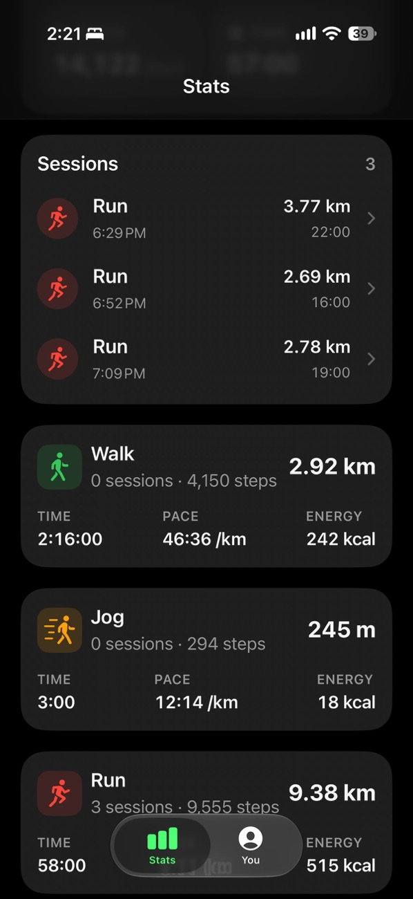
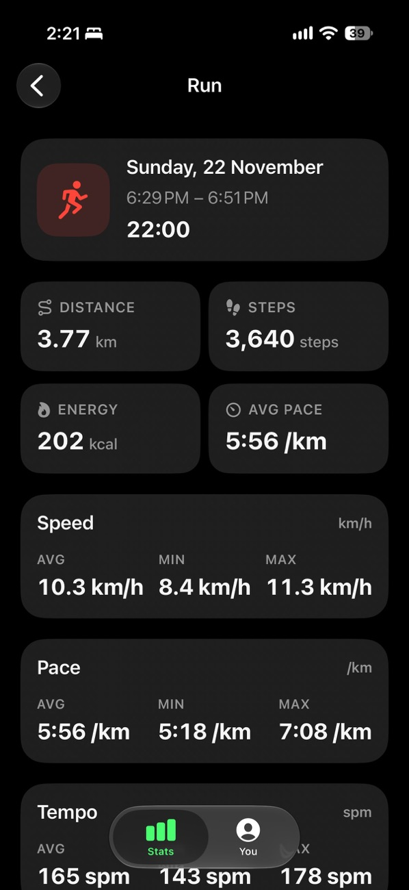
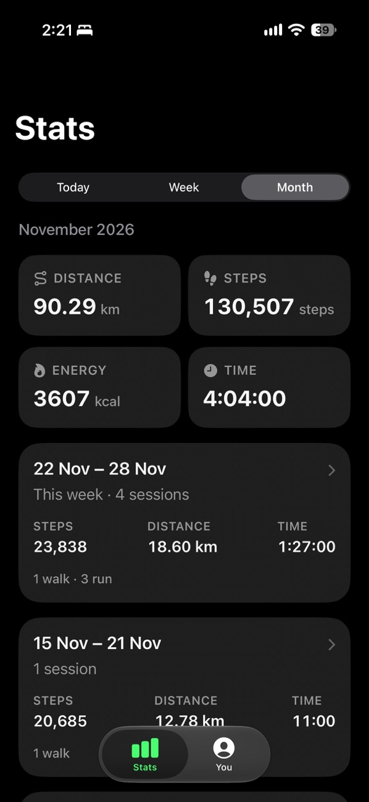
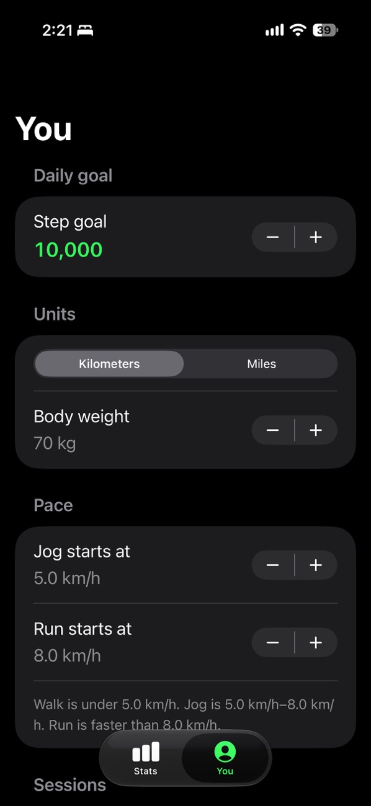

# RunCheck: Walk & Run Stats

RunCheck turns the steps and workouts already in Apple Health into clear walk, jog and run stats on iPhone. It sorts your movement by speed, lists real sessions (not pacing around the house), and shows daily, weekly and monthly totals.

No account, no ads, works offline. RunCheck only reads Apple Health, and your data never leaves your iPhone.

<p align="center">
  
  
  
  
  
</p>

## Features

### Stats
- **Today**: a step ring against your daily goal, plus distance, energy and active time.
- **Week**: Sunday to Saturday. Swipe between weeks and tap a day to see it.
- **Month**: monthly totals, then a tile for each week (newest first). Tap a week to open it.
- **Walk, jog and run tiles**: time, pace, energy, steps and number of sessions for each kind. A tile hides when there's nothing for that kind.

### Sessions
- Walks, jogs and runs found in Apple Health, listed with distance and duration.
- A detail screen for each session: distance, steps, energy, average pace, and the average, minimum and maximum for speed, pace and tempo (steps per minute), with a speed graph.
- Walk sessions only count steady walks, so moving around at home or in the office stays in the Walk tile and isn't listed.

### You
- **Daily goal**: step goal from 1,000 to 40,000.
- **Units**: kilometres or miles, and body weight (used to estimate energy).
- **Pace**: the speeds where a jog and a run start.
- **Sessions**: the minimum length and the join window for walks, jogs and runs.
- **Apple Health**: access status, and a shortcut to manage it in the Health app.
- **About**: Privacy Policy and Support links.

## How activity is classified

Defaults, all editable in **You**:

| Kind | Speed | Minimum session | Breaks joined if shorter than |
|---|---|---|---|
| Walk | under 5 km/h | 10 min | 2 min |
| Jog | 5 to 8 km/h | 5 min | 30 s |
| Run | over 8 km/h | 5 min | 10 s |

Health data is loaded into memory on launch and when you pull to refresh. Switching between Today, Week and Month doesn't query Health again. HealthKit background delivery refreshes step totals when Health gets new data.

## Privacy

- **Read only.** RunCheck reads steps, walking and running distance, walking and running speed, active energy, exercise minutes and workouts. It never writes to Apple Health.
- **Nothing leaves the iPhone.** No servers, accounts, analytics, ads or third-party SDKs. Health data isn't stored in iCloud.
- **Update check.** About once a day RunCheck asks Apple's App Store lookup service (`itunes.apple.com/lookup`) for its latest version number and offers to open the App Store if a newer one is out. The request carries only the app's App Store ID and a country code. It's the only network request the app makes.
- **Settings** (goal, units, weight, thresholds) are saved on the device.

App Store privacy label: **Data Not Collected**. Full policy: [mujassir.github.io/ios-fitness-app/privacy](https://mujassir.github.io/ios-fitness-app/privacy). Support: [mujassir.github.io/ios-fitness-app/support](https://mujassir.github.io/ios-fitness-app/support).

## Requirements

- macOS with Xcode 16 or later, and [XcodeGen](https://github.com/yonaskolb/XcodeGen)
- An iPhone running iOS 18 or later (HealthKit works best on a real device with Health data)
- An Apple developer team for signing (HealthKit needs a signed build)

## Build and run

```bash
brew install xcodegen   # if needed
xcodegen generate
open Stride.xcodeproj
```

Choose your development team in Xcode, then run on an iPhone. On first launch, tap **Continue**, then **Turn On All** and **Allow** on the Health sheet. Pull down on Stats to refresh.

`project.yml` is the source of truth. Edit it, not the `.xcodeproj`, then run `xcodegen generate` again.

## Project

| | |
|---|---|
| App Store name | RunCheck: Walk & Run Stats |
| Bundle ID | `com.mujassir.runcheck` |
| Version | 1.0.0 (build 2), iPhone only |
| Project spec | `project.yml` (XcodeGen). The target and folder are still called `Stride`, the app's working name |
| Store and review docs | [`docs/appstore/`](docs/appstore) (metadata, review notes, readiness checklist) |
| Website | [`docs/`](docs), published with GitHub Pages |
| License | [Apache 2.0](LICENSE) |

### Not in 1.0

GPS workout recording (the Move and Log screens, live routes and saving workouts to Health) is in the repo but excluded from the 1.0 target in `project.yml`. It needs location access and Health write access, which 1.0 doesn't ask for. It's planned for a later version.
