# RunCheck features

RunCheck reads the steps, distance, speed and energy already in Apple Health and turns them into walk, jog and run stats. It only reads Health. It never records workouts or writes to Health.

This page lists everything in the app as of November 2026, including the changes since 1.0.0 (build 2).

## Contents

- [Tabs](#tabs)
- [Daily, Week and Month](#daily-week-and-month)
- [Summary](#summary)
- [Running, Jogging and Walk](#running-jogging-and-walk)
- [Steps](#steps)
- [Energy](#energy)
- [Sessions](#sessions)
- [Session detail](#session-detail)
- [You (settings)](#you-settings)
- [Health access](#health-access)
- [App updates](#app-updates)
- [Speed and loading](#speed-and-loading)
- [Colours](#colours)
- [What's new since 1.0.0](#whats-new-since-100)

## Tabs

The bottom bar has **Summary**, up to five optional tabs, and **You**.

| Tab | Shows | On by default |
|---|---|---|
| Summary | Every kind together: rings, totals and activity cards | Always |
| Running | Running distance, time, pace, energy, steps and sessions | Yes |
| Jogging | The same for jogging | No |
| Walk | The same for walking | No |
| Steps | Steps against the step goal, distance and energy | No |
| Energy | Active energy against the energy goal, and energy by kind | No |
| You | Settings | Always |

- Turn tabs on or off in **You → Tabs**.
- When the tabs don't all fit, the bar scrolls sideways. Each tab keeps a minimum width, so labels never squash.
- The selected tab gets a centred highlight. Icons always show their kind's colour, and the label takes the colour when the tab is selected.
- The bar floats over the content. Every screen leaves room at the bottom, so the last card scrolls clear of the bar.

  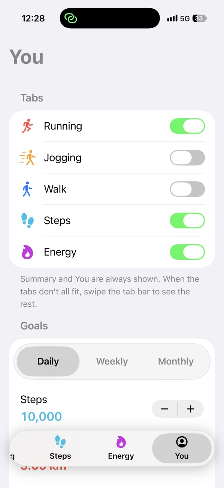
  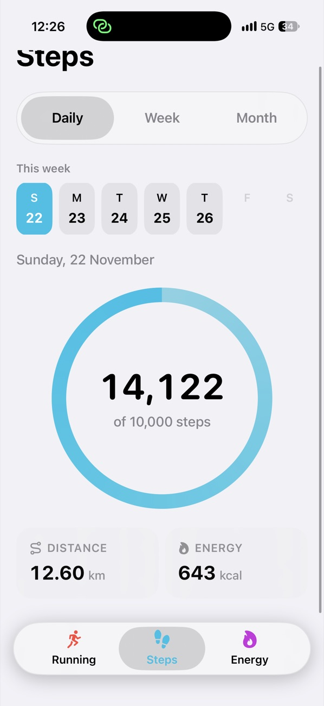

## Daily, Week and Month

Every stats tab has a **Daily / Week / Month** picker at the top. It's the same height and style as the bottom bar.

- **Daily** shows a strip of this week's days (Sunday to Saturday). Tap a day to see it, and swipe the strip to go to earlier weeks. Future days are greyed out.
- **Week** shows this month's weeks as **Week 1**, **Week 2** and so on, with their dates (for example 22–28). Tap a week to see it, and swipe to go to other months.
- **Month** shows the whole month.

The choice is shared across tabs. If you pick 24 November in Daily on Summary and then open Running, Running also shows 24 November. The same goes for the chosen week and month. The scroll position is kept too, so going from Energy's "By each day" list to Steps keeps your place.

The day and week chips take the colour of the tab you're on.

## Summary

  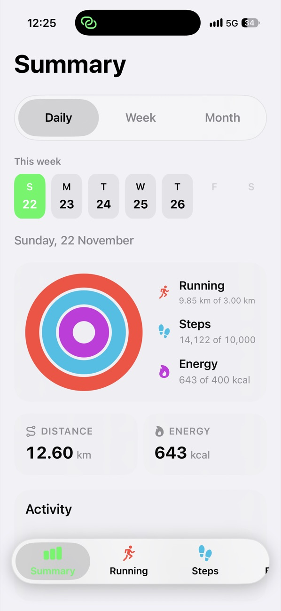
  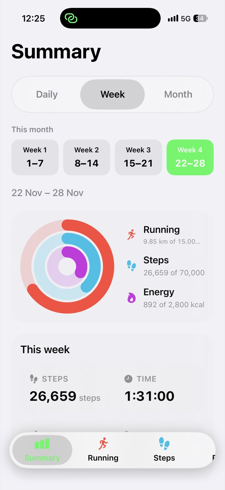
  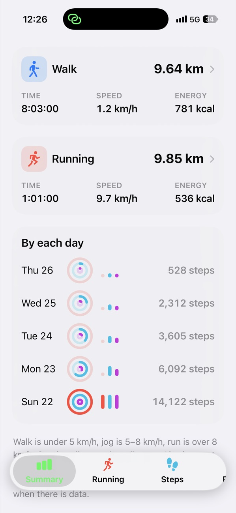
  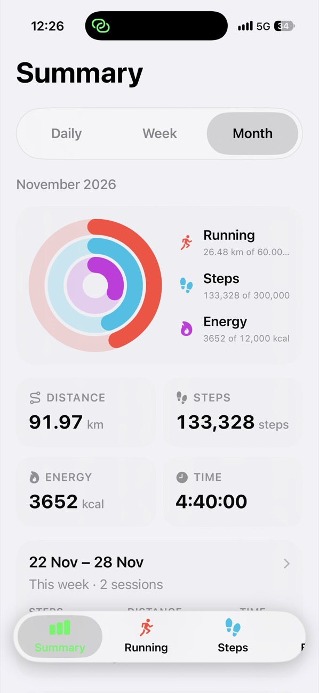
  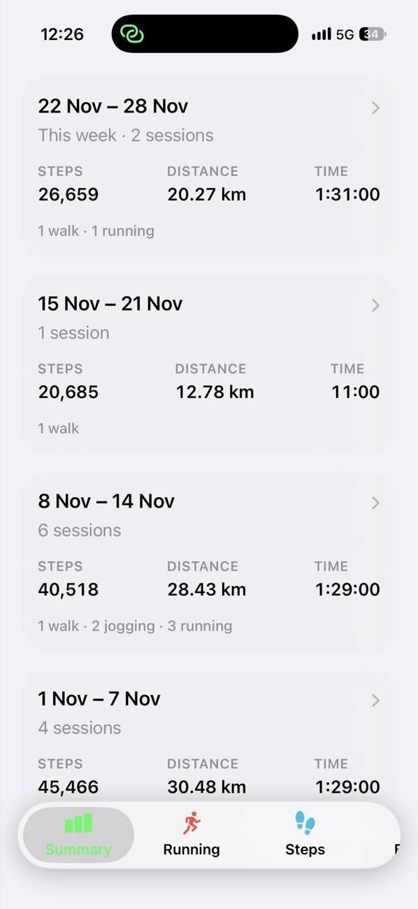

- **Rings**: one ring per tab that's on (Running, Jogging, Walk, Steps, Energy), one inside the other. Each fills against its own goal for the period (daily goal in Daily, weekly in Week, monthly in Month). A ring with nothing in it is hidden. Next to the rings, each kind shows its value and goal, such as "9.85 km of 3.00 km".
- **Totals**: distance, steps, energy and time for the day, week or month.
- **Activity cards**: one card each for Walk, Jogging and Running, with distance, time, average speed and energy. A card only shows when that kind has at least one session. It says "N sessions" only when there's more than one.
  - Tap a card with one session to open that session's detail.
  - Tap a card with several sessions to open the list of them.
- **By each day** (Week only): each day of the week with a small set of rings, a coloured bar per kind and the day's steps. It comes after the activity cards.
- **Month**: after the totals, a card for each week of the month (newest first) with steps, distance, time and the sessions by kind, such as "1 walk · 2 jogging · 3 running". Tap a week to open it.

## Running, Jogging and Walk

  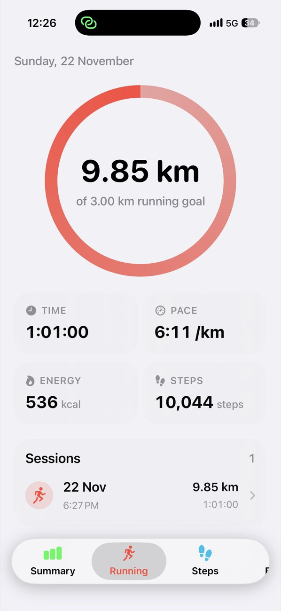
  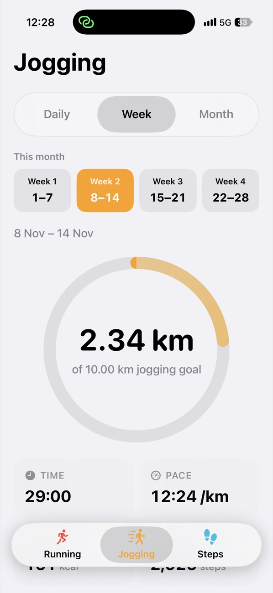
  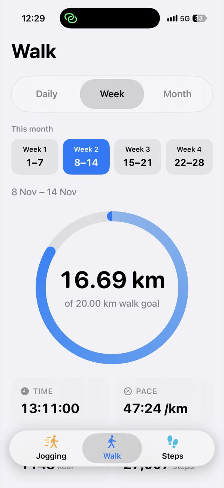

Each kind has its own tab:

- A large ring with the distance against that kind's goal for the period, for example "9.85 km of 3.00 km running goal".
- Time, pace, energy and steps tiles.
- **By each day** (Week and Month): the distance for each day.
- **Sessions**: that kind's sessions, newest first. Each row shows the date (like "22 Nov") as the title, the start time below it, and the distance and duration on the right. The section is hidden when there are none.

## Steps

  
  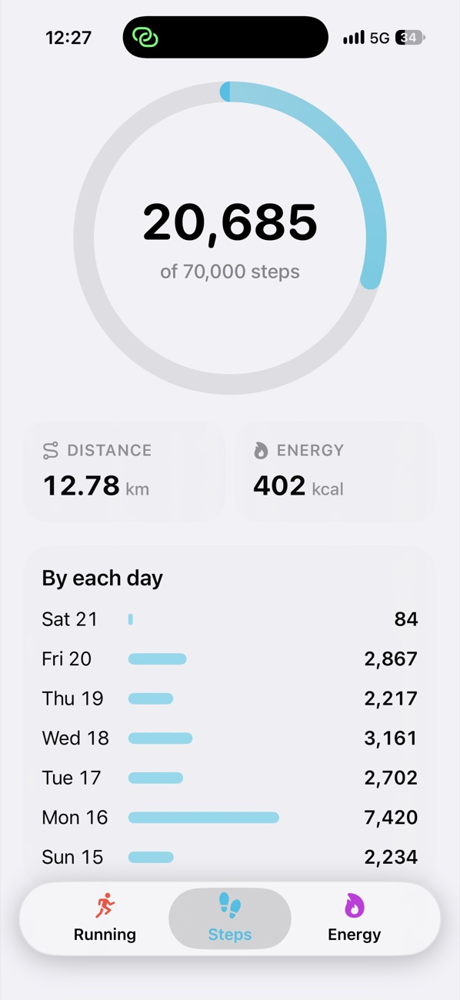

- A ring with steps against the step goal for the period.
- Distance and energy tiles.
- **By each day** (Week and Month): a bar and the step count for each day.

## Energy

  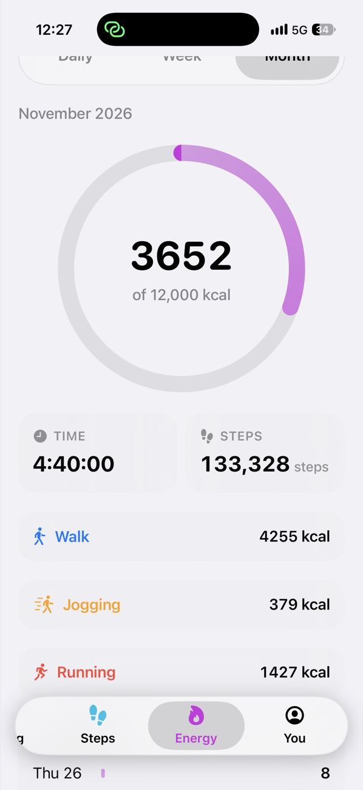

- A ring with active energy (kcal) against the energy goal for the period.
- Time and steps tiles.
- Energy by kind: Walk, Jogging and Running.
- **By each day** (Week and Month): a bar and the energy for each day.

## Sessions

RunCheck builds sessions from Health's minute-by-minute steps, distance and speed.

- Each minute is sorted by speed into walk, jog or run. Defaults: walk under 5 km/h, jog 5 to 8 km/h, run over 8 km/h.
- Runs are found first, then jogs, then walks. Each minute belongs to one session only, so a slower minute inside a run doesn't also show up as a separate jog or walk.
- A session absorbs short pauses and short slower stretches, up to 3 minutes, such as a walk break during a run. A 61-minute run with a few slow minutes counts as one run, not as three runs and a jog.
- A session has to last a minimum time to count. Defaults: walk 10 min, jog 5 min, run 5 min.
- Walk sessions only count steady walks. Moving around at home or the office still adds to the Walk totals, but isn't listed as a session.

| Kind | Speed | Minimum session | Breaks joined if shorter than |
|---|---|---|---|
| Walk | under 5 km/h | 10 min | 2 min |
| Jogging | 5 to 8 km/h | 5 min | 30 s |
| Running | over 8 km/h | 5 min | 10 s |

Because Health data comes in one-minute steps, a break is always joined if it's a minute or less, whatever the setting. All of these can be changed in **You → Pace** and **You → Sessions**.

## Session detail

Tap a session to open it:

- The date, start and end time, and duration.
- Tiles in this order: **Distance**, **Avg speed**, **Energy**, **Steps**.
- **Speed**, **Pace** and **Tempo** cards with average, minimum and maximum. The unit (km/h, min/km, spm) is shown once in the card's header, not after every number.
- A **Graph** of speed, pace or tempo over the session.
- **Each km** (or **Each mile**): the time and speed for each kilometre, from 1 to the end. The last row is a partial kilometre when the distance isn't a whole number.

## You (settings)

  
  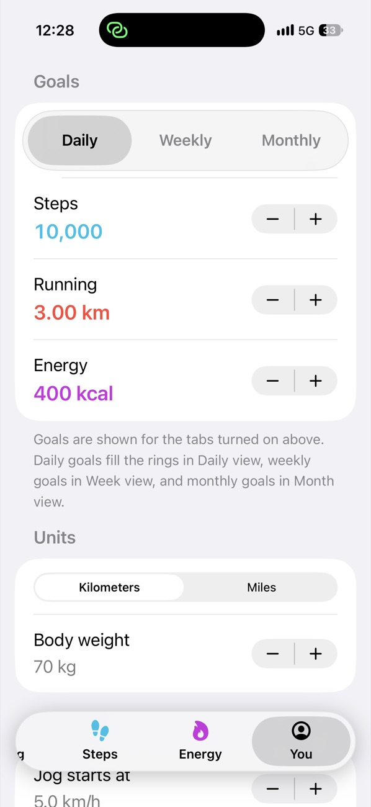

- **Tabs**: turn Running, Jogging, Walk, Steps and Energy on or off. The switches use the system colour, and each icon shows its kind's colour.
- **Goals**: pick **Daily**, **Weekly** or **Monthly**, then set the goals for that period. Only the tabs that are on show a goal. If no tab is on, the steps goal still shows, because Summary then uses a steps ring.

  | Goal | Daily | Weekly | Monthly |
  |---|---|---|---|
  | Steps | 10,000 | 70,000 | 300,000 |
  | Running | 3 km | 15 km | 60 km |
  | Jogging | 2 km | 10 km | 40 km |
  | Walk | 3 km | 20 km | 80 km |
  | Energy | 400 kcal | 2,800 kcal | 12,000 kcal |

- **Appearance**: **System** (the default, follows the iPhone), **Light** or **Dark**. Alerts and sheets follow it too.
- **Units**: kilometres or miles, and body weight (used to estimate energy).
- **Pace**: the speeds where jogging and running start.
- **Sessions**: for walk, jog and run, the minimum session length and the join window.
- **Apple Health**: whether Health is available, whether access is set up, and a button to allow access or manage it in the Health app.
- **About**: version, **Check for Updates** (or **Update to x.y** when a newer version is out), Privacy Policy and Support.

## Health access

- On first launch, RunCheck explains what it reads and asks for Health access.
- If access is missing later (for example the categories were turned off, or the sheet was dismissed), RunCheck asks again on launch. If Health still returns no data at all, it shows **No Health data** with **Open Health**, **Try Again** and **Not Now**. iOS doesn't tell apps which read permissions were denied, so "no data at all" is the signal.
- Stats refresh when the app comes back from the background, and when you pull down to refresh. HealthKit background delivery refreshes step totals when Health gets new data.

## App updates

- About once a day, RunCheck asks Apple's App Store lookup service for the latest version number. If a newer version is out and your iOS version supports it, it shows an alert with **Update** (opens the App Store page) and **Not Now**.
- Choosing **Not Now** skips that version, so the alert doesn't keep coming back. You can still update from **You → About**.
- This is the app's only network request. It sends only the app's App Store ID and a country code.

## Speed and loading

- Week and Month results are worked out once and cached, so going back to Month is instant.
- This week and this month are prepared in the background after Health data loads, and again after you change a setting that affects the stats (pace, session lengths, body weight).
- If a period isn't ready yet, a small loading card shows instead of an empty screen.
- Only the tab on screen is built, which keeps switching tabs quick.

## Colours

Each kind has one colour, used for its tab icon, rings, chips, cards and goal values:

| Kind | Colour |
|---|---|
| Summary | Green |
| Running | Red |
| Jogging | Orange |
| Walk | Blue |
| Steps | Cyan |
| Energy | Purple |
| You | System default |

## What's new since 1.0.0

1.0.0 had two tabs (Stats and You), a single daily step goal and a sessions list on the Stats tab. Since then:

**Navigation**
- Stats is now **Summary**, and there are new optional **Running**, **Jogging**, **Walk**, **Steps** and **Energy** tabs. Only Running is on by default.
- The tab bar scrolls when there are more tabs than fit.
- **Today** is now **Daily**. The day strip moved to Daily, and Week shows the month's weeks as **Week 1–5** chips that you swipe by month.
- The Daily/Week/Month choice, the selected day or week, and the scroll position are kept when you switch tabs.

**Summary**
- Concentric rings, one per tab that's on, with empty rings hidden.
- Walk, Jogging and Running cards only show when there's a session. You can tap them.
- A **By each day** section in Week.

**Sessions**
- Sessions moved to their kind's tab, and the section hides when it's empty.
- Better session detection: a long run with short slower stretches stays one run.
- Session rows show the date as the title.
- Session detail now has an **Avg speed** tile, cleaner Speed/Pace/Tempo cards and an **Each km** section.

**Settings**
- Daily, weekly and monthly goals for steps, energy and each kind. Only the tabs that are on show their goals.
- An **Appearance** setting: System, Light or Dark.

**App**
- Version check with an update prompt, and a Check for Updates button.
- Health access is asked for again when it's missing.
- Week and Month are cached and prepared in the background, with a loading card.
